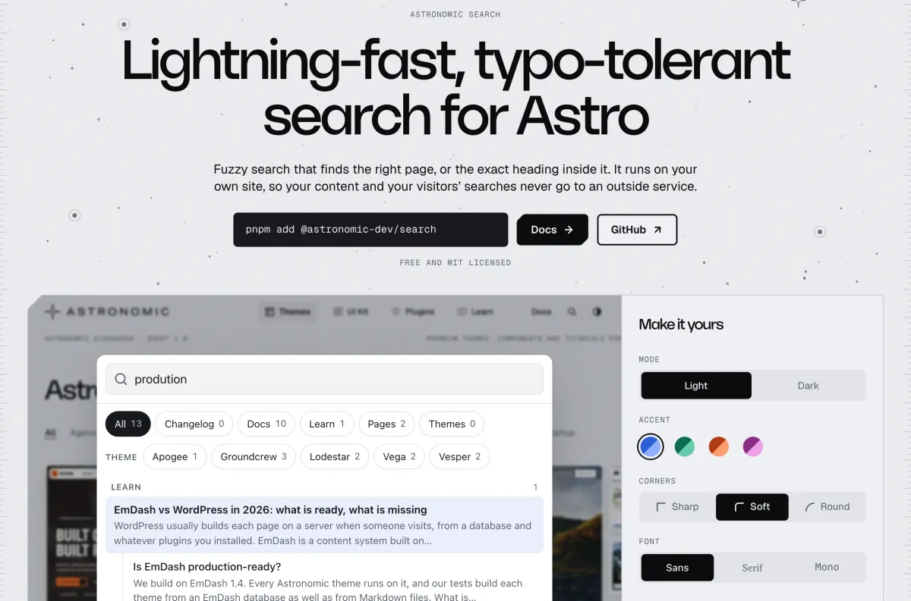

# @astronomic-dev/search

[](https://astronomic.dev/plugins/search)

See it live and read the guide at [astronomic.dev/plugins/search](https://astronomic.dev/plugins/search).

Fuzzy search in a dialog for any Astro site. It indexes your pages and their headings at build time, ships the index as a hashed file, and loads it only when a visitor reaches for search: on hover, focus, a click or the shortcut. Typos still find the page ("nortwind" finds "Northwind rebrand"), and a match inside a section links straight to its heading. Only real matches are marked: a word that a query word equals or starts ("lodes" marks "Lodestar"). A word found only by a typo match shows its result with no mark, so "code" never marks "come" and "button" never marks "bottom" (nor "lodestr" "Lodestar").

- **Records first.** Everything becomes the same small record (a page, a heading's section, or an action), whatever it came from: content collections, built HTML, or your own code.
- **Three layers.** A headless controller, accessible browser behavior, and a default dialog. Use the dialog as is, or build your own on the lower layers.
- **No JavaScript needed to get somewhere.** The search button is a real link to `/search` (or a page you pick), and a `<noscript>` part shows your browse links.
- **Strict CSP friendly.** Scripts ship as files and styles as a constructable stylesheet, so `script-src 'self'; style-src 'self'` works.

## Install

```sh
pnpm add @astronomic-dev/search
```

npm and yarn work too. Search adds no dependency with an install script (its browser scripts come bundled), so it brings no `pnpm approve-builds` step of its own. Needs Astro 7 for the integration and components; the core, controller and dom layers work anywhere.

Add the integration to `astro.config.mjs`, then put the search button where your header has room:

```js
// astro.config.mjs
import { defineConfig } from "astro/config";
import search, { collections, html } from "@astronomic-dev/search/astro";

export default defineConfig({
	site: "https://example.com",
	integrations: [
		search({
			sources: [collections({ docs: { label: "Docs" } }), html({ include: ["/", "/pricing"] })],
			browse: [{ label: "Docs", href: "/docs" }],
		}),
	],
});
```

```astro
---
import SearchLink from "@astronomic-dev/search/astro/SearchLink.astro";
import SearchNoscript from "@astronomic-dev/search/astro/SearchNoscript.astro";
---

<header>
	<SearchLink class="search-button">Search</SearchLink>
	<SearchNoscript />
</header>
```

The build writes the index, the manifest and two scripts to `/_search/`, and the button opens the dialog. Last, add the search page.

### The search page

The button is a link to `/search` (with your `base`, and a trailing slash when `trailingSlash` is `"always"`, or `"ignore"` with the default `build.format`). Visitors land there with JavaScript off, and from "See all results" in the dialog, which adds the query as `?q=`. Add the page with the `SearchPage` component, inside your own layout. It reads `?q=`, lists the matching pages, and shows your browse links with JavaScript off. It takes `heading` (default "Search", `""` for none), `label` (the search box's label, default "Search this site"), `button` (default "Search") and `class`. It reads `<html lang>` to pick the index's language:

```astro
---
// src/pages/search.astro: where "See all results" and the no-JavaScript link go. Use your own layout in place of
// this html shell, and keep the noindex tag.
import SearchPage from "@astronomic-dev/search/astro/SearchPage.astro";
---

<html lang="en">
	<head>
		<meta charset="utf-8" />
		<meta name="viewport" content="width=device-width, initial-scale=1" />
		<meta name="robots" content="noindex" />
		<title>Search</title>
	</head>
	<body>
		<main>
			<SearchPage />
		</main>
	</body>
</html>
```

It searches the default index and ignores the `type` and filter parameters a trigger may add. For another index or other markup, write the page yourself: start from `dist/astro/SearchPage.astro` in the package, with its relative imports changed to `@astronomic-dev/search/controller` and `@astronomic-dev/search/core`, and put another index name in place of `assets.index`. If your search page lives somewhere else, set `href` on `SearchLink` (see The dialog element).

## Settings

The settings come in two forms.

**One index.** Put the index settings at the top level. The index is named `default`.

```js
search({
	sources: [collections({ docs: { label: "Docs", facets: ["theme"] } }), html({ include: ["/", "/pricing"] })],
	weights: { title: 3, heading: 2, text: 1, keywords: 1 },
	group: { dialog: "type" },
	types: { themes: { weight: 1.5 } },
	shortcut: { keys: ["mod+k", "/"] },
	browse: [{ label: "Docs", href: "/docs" }],
});
```

**Named indexes.** Each index gets its own files, so a big part of the site (a component catalog, for example) does not slow down the main search.

```js
search({
	indexes: {
		site: { sources: [collections({ docs: {} }), html()] },
		kit: { sources: [records(loadParts, { types: { kit: { label: "Kit parts" } } })], group: { dialog: false } },
	},
	default: "site",
});
```

| Setting | Where | What it does |
| --- | --- | --- |
| `sources` | index | Where the records come from (see Adapters). Required. |
| `weights` | index | Field boosts: `title`, `heading`, `text`, `keywords` (a page's keywords and its facet values). Default 3, 2, 1, 1. |
| `group` | index | `{ dialog, page }`: `"type"`, a facet name, or `false` (one list by score). Default: by type in the dialog, mixed on a page. |
| `groupOrder` | index | `"best"` (the group with the best match first) or a fixed list of group keys. |
| `types` | index | Per type: a `label` and a score `weight` (default 1). |
| `facets` | index | Per facet: a `label` and labels for its `values`. No source or index may name a facet `type` (the content type) or `q` (the search page reads `?q=` as the query); the build fails on one. |
| `budget` | index | `{ gzipKB }`: a build warning when the index file grows past it. Default 300 KB. |
| `clip` | index | Characters of each section's text the index file keeps, at least 200: for a smaller file on a large site. Leave out to keep the text whole (the default). Words past the cut are still found, and a result still links to their section, but its preview shows the start of the section. The first 1,000 characters of a section rank higher than the rest, with or without `clip`. |
| `suggested` | index | Links the dialog shows in an empty box, under "Suggested" and before recent searches: `[{ label, href, type? }]`, at most 8. One list for every locale, or one per locale (`{ en: [...], fr: [...] }`; a locale the map leaves out shows none). Each `href` must be a canonical URL on this site, as a record's, and `type` one of the index's types; the build fails otherwise. |
| `synonyms` | index | Groups of words that match each other, one word each: `[["docs", "documentation"], ["price", "cost"]]`. A query word in a group is searched as any word of its group, and a page that matches the other word counts as matching it. Case and accents do not matter. |
| `pinned` | index | A whole query to pages shown first, in that order: `{ "get started": ["/docs/install", "/docs/first-steps"] }`. The query is matched whole, ignoring case, accents and extra spaces, not word by word. A pinned page shows even if the words do not match it, but only when it passes the type tab, the dialog's `types` and the filters, and it counts once in the counts like any page. Each URL must be a canonical page URL in the index; the build fails otherwise (the dev server warns, since it does not scan built HTML). |
| `indexes` | site | Named indexes: `{ name: { sources, ... } }`, each with the index settings above. A name is letters, digits, `-` and `_`, starts with a letter or digit, and is unique ignoring case (it becomes part of the index's file names). Built-in object keys (`__proto__`, `constructor`, `prototype`, `toString` and the other `Object.prototype` names) are reserved; the build fails on one. |
| `default` | site | The index a button uses when it names none. |
| `shortcut` | site | `{ keys: [...] }` or `false`. Default `["mod+k", "/"]`. |
| `strings` | site | Labels that replace the US English defaults (see Strings). |
| `browse` | site | Links for the error state and the no-JavaScript part: `[{ label, href }]`. Each `href` must be a canonical URL on this site (with `trailingSlash: "ignore"`, either slash); the build fails otherwise. |

## Adapters

- **`collections({ name: spec })`** reads Astro content collections. Each entry is a page record, and each heading (levels 2 and 3 by default) starts a section record with its rendered anchor. A spec takes `type` (the records' type, so two collections can share one: `hubs: { type: "learn" }` makes hubs Learn results; default the collection's name), `label` (the type's label; collections of one type may not set different labels, and one without a label takes the other's), `url` (the page's URL pattern: `{id}` is the entry's id, `{slug}` its `slug` field or else its id; default `/<collection>/{id}`, so `docs: {}` gives `/docs/getting-started`; set it to match your route, such as `blog: { url: "/posts/{slug}" }`; your `base` and `trailingSlash` are applied for you), `facets`, `fields` (extra data fields to index, for data-only collections), `title`, `depths`, `keywords` (see Keywords) and `filter`. Drafts and `noindex` entries are always left out. An entry whose `url` gives a URL on another site (a slug of `/other.example/x` with the pattern `/{slug}`) fails the build, naming the collection and entry.

  `filter: (entry) => boolean` keeps the entries it returns `true` for, as a page route's `getStaticPaths` does: `docs: { url: "/docs/{id}", filter: (e) => !unlisted.has(e.id.split("/")[0]) }`. It sees `{ id, collection, data }`. It runs in the integration after the records route, so `data` is the entry's data as JSON (a date is an ISO string), and it must not need `astro:content`.
- **`html({ include, exclude, type, label, selector })`** scans the built HTML. It reads `[data-search-body]`, else `main`, else the body, and splits the page at its headings. Dialogs (`<dialog>`, `[data-search-dialog]`, `<astronomic-search>`) are never page text, nor is anything `hidden`, `aria-hidden="true"` or `[data-search-ignore]`. Pages with `noindex` are left out. The text gets a space between block elements, at `<br>`, and between the items of a flex or grid container (a `flex` or `grid` class, with any variant prefix, or an inline `display` style), so cards and badges side by side do not run together; inline tags (`span`, `b`, `em` and the like) join with no space. A path segment `*` matches any one segment.
- **`records(hook, { types, facets })`** takes records your own code returns: a CMS this package does not know, a component catalog, or actions with no URL (an action has a `command` and the dialog fires a `search:command` event).

When two sources give the same URL, the collection record wins over the scanned page.

After the build, every collection and `html()` record URL must be a built page (`<path>.html` or `<path>/index.html`), and every section's anchor an `id` that page renders; the build fails with a list otherwise, so a `url` pattern that misses its route, or a page left out of `getStaticPaths` but not by `filter`, never makes a dead result. With `output: "server"` a page may be rendered on demand, so these are warnings. A `records()` hook's URLs are its own and are not checked. The dev server has no built pages and does not check.

### Keywords

A page can carry extra words that people search for but the page does not use, so "start" finds a page titled "Lodestar". Keywords are indexed in the `keywords` field, with the page's facet values. Each source has its own way to set them:

```md
---
title: Lodestar
searchKeywords: [start, guide, north]   # or "start, guide, north"
---
```

```html
<meta name="search:keywords" content="start, guide, north">
```

```js
collections({ docs: { keywords: "tags" } });  // read another field
collections({ docs: { keywords: false } });   // no keywords
records(() => [{ id: "en:/ui/button", kind: "page", url: "/ui/button", type: "kit", title: "Button", text: "", keywords: ["cta"] }]);
```

Only page records take keywords, not headings. Each keyword is trimmed and empty ones are left out. A page keeps its first 20 keywords, and the build warns about any page with more. When a collection page replaces a scanned page, it keeps its own keywords and none of the scanned ones.

## The three layers

| Layer | Import | Use it when |
| --- | --- | --- |
| Default dialog | `@astronomic-dev/search/ui` (loaded for you by `SearchLink`) | You want search working today and will theme it with custom properties and parts. |
| Browser behavior | `@astronomic-dev/search/dom` | You render your own markup and want the dialog, combobox, tabs, shortcut and live region done right. `mountSearch({ trigger, dialog, input, listbox, live, controller, idFor, keys })` returns an `unbind()`. |
| Controller | `@astronomic-dev/search/controller` | You want only the state: query, loading, results, the active option, type tabs, facet picks and recent searches. No DOM, so it runs anywhere. In an empty dialog box, `state.options` holds the index's suggested links (`kind: "suggested"`, with `url`, `label` and `type`), so a recipe renders them as options. |

The core (`@astronomic-dev/search/core`) holds the record types, the engine and `createSearch`, for code that searches an index without any UI. The dom layer also exports `marked(document, text, ranges, attrs?)`, the one way to render result text: text nodes with a `<mark>` (with `attrs`, default `part="mark"`) around each matched range, never markup.

### Build your own dialog

A dialog of your own still gets the lazy load: call `startBoot({ selector, keys, load })` from `@astronomic-dev/search/boot` in your button's script. It listens for hover, focus, a click and the shortcut, calls `load()` on first use (your app, through `import()`), calls the app's `prepare(trigger, keys)`, then replays the held click or key; if the load fails, a held click follows the link. To fetch the index while your app loads, pass `preload(trigger)` as well: call `prefetch({ index, lang, manifestUrl, fetch })` from `@astronomic-dev/search/controller` there, and hand what it returns to your app's `loadSearcher` as `prefetch`. `loadSearcher` uses it once, and only for the same index and manifest URL. Give your buttons `data-search-ui="yours"` and pass `selector: '[data-search-trigger][data-search-ui="yours"]'`: the default dialog's boot and app skip any trigger with a `data-search-ui`, so the two never take each other's buttons. Use one kind of dialog per page. The integration's settings reach your code through `virtual:astronomic-search/assets`, which exports `{ boot, app, manifest, index, shortcut, browse, strings }` (`strings` holds the `strings` setting's overrides only); for its types, add `/// <reference types="@astronomic-dev/search/astro/virtual" />` to the file that imports it.

For a worked example, see the Search family in [`@astronomic-dev/ui`](https://astronomic.dev/ui): the shell [`Search.astro`](https://github.com/astronomic-dev/astronomic-ui/blob/main/src/components/Search.astro) (its markup, templates and boot script), the glue [`lib/search-app.ts`](https://github.com/astronomic-dev/astronomic-ui/blob/main/src/lib/search-app.ts) on `controller` and `dom`, and the [`SearchClassic`](https://github.com/astronomic-dev/astronomic-ui/blob/main/src/components/SearchClassic.astro) recipe, which sets only class hooks.

## The dialog element

`SearchLink` loads a small boot script. On first use it loads the app, which defines `<astronomic-search>` and adds one to the page per kind of button. At the same time it fetches the manifest, then the index file the manifest names, so the index is often in by the time the app is. You can also place it yourself.

| Attribute | What it does |
| --- | --- |
| `index` | The index to search. Default: the `default` setting. |
| `types` | A comma list of the types this dialog shows. Default: all of the index's types. |
| `group` | `type`, a facet name, or `false`: overrides the index's `group.dialog` for this dialog. |
| `theme` | `light` or `dark`. Default: the visitor's system setting. |

`SearchLink` takes the same choices as props (`index`, `types`, `group`), plus `main` (the button the shortcut belongs to; default the first on the page) and `class`. Its slot is the label.

`href` sets where the link goes with no JavaScript, and where "See all results" goes (with `?q=` and the query added). Default: `/search` under your `base`, with a trailing slash when your `trailingSlash` setting calls for one. Set it when your search page lives elsewhere, or when you have none and want the link to go to a docs index instead:

```astro
<SearchLink href="/docs">Search the docs</SearchLink>
```

The build checks the default. When a page has a `SearchLink` with no `href` and the build wrote no search page (`search/index.html` or `search.html`), it logs one warning: add a `/search` page, or set `href`. It is a warning, not an error, because the dialog still works. A `/search` page rendered on demand writes no file, so it warns too; set `href="/search"` to quiet it.

With `build.format: "file"`, Astro writes `search.html`, and result links have no `.html`. Most hosts (Cloudflare Pages, Netlify, Vercel) serve `/search` from `search.html` for you. On a host that does not, turn on its clean-URL or rewrite setting.

An action record (a `command`, no URL) fires a `search:command` event when it is picked. The event bubbles out of the dialog's shadow root, so listen on the element or on the document: `document.addEventListener("search:command", (e) => run(e.detail.command))`.

### Open on a search

A trigger can open the dialog with a search already typed. Give it any of these attributes; they replace what the box held, and a trigger with none of them opens on the last search. Point its `href` at the same search on your `/search` page, so the link still works with no JavaScript.

| Attribute | What it does |
| --- | --- |
| `data-search-query` | The words in the box. |
| `data-search-type` | The type tab to select. Default: all types. |
| `data-search-filters` | Facet picks in the search page's URL form: `theme=lodestar`, a name repeated for several values (`theme=lodestar&theme=vega`). Ignored by an engine with no facets. |

```astro
<SearchLink href="/search?q=dark+mode&type=docs&theme=lodestar" data-search-query="dark mode" data-search-type="docs" data-search-filters="theme=lodestar">
	Dark mode in the Lodestar docs
</SearchLink>
```

Any trigger works, the kit's too: the dom layer's `bindTrigger` reads them (`triggerStart()` from `@astronomic-dev/search/dom`) and calls `controller.open(start)`, which takes `{ query, type, picks }`. The dialog a trigger opens is still the one its `index`, `types` and `group` name, so these links share the page's one dialog and its shortcut.

### Custom properties

Set these on `astronomic-search` or any ancestor. Each has a light default and a dark one.

| Property | Default (light) | Use |
| --- | --- | --- |
| `--search-font` | system UI font | Every text in the dialog |
| `--search-bg` | `#ffffff` | Dialog background |
| `--search-fg` | `#16181d` | Text |
| `--search-muted` | `#5c6370` | Snippets, labels, hints |
| `--search-border` | `#dfe2e7` | Lines and outlines |
| `--search-line` | the border, 60% toward the background | The rail beside heading results |
| `--search-accent` | `#2c5fd6` | Links, picked filters, the active option's tint |
| `--search-accent-fg` | `#ffffff` | Text on the accent |
| `--search-mark-bg` | `#fdeaa6` | Matched words |
| `--search-mark-fg` | `inherit` | Matched words' text |
| `--search-radius` | `0.75rem` | Dialog corners (inner corners follow) |
| `--search-shadow` | soft drop shadow | Dialog shadow |
| `--search-width` | `40rem` | Dialog width on wide screens |
| `--search-backdrop` | dark, 45% | The backdrop behind the dialog |
| `--search-focus` | `#2c5fd6` | Focus rings |

On screens up to `40rem` wide the dialog fills the screen and respects the safe areas. With reduced motion it opens without animation.

### Parts

Style any piece with `astronomic-search::part(name)`. These names are stable.

| Part | Element |
| --- | --- |
| `dialog` | The `<dialog>` |
| `panel` | The box inside it |
| `header` | The row with the search box and the close button |
| `input` | The search box |
| `close` | The close button |
| `tabs` | The type tabs row |
| `tab` | One type tab |
| `facets` | The filter row |
| `facet` | One filter button |
| `results` | The results list |
| `group` | One group of results |
| `group-label` | A group's heading: its name, then the group's count (`group-count`) on the right |
| `group-count` | A group's count, in its `group-label`: grouped by type, the type's match count (as on its tab); else the pages listed |
| `option` | One result (a page or a heading; `data-kind` says which), or a suggested link (`data-kind="suggested"`) |
| `option-title` | A page result's title |
| `option-heading` | A heading result's heading |
| `snippet` | The text under a result |
| `mark` | A matched word |
| `type-label` | A result's type, when results are not grouped |
| `empty` | The no-results message |
| `error` | The "not available" message |
| `recent` | Recent searches |
| `suggested` | The suggested links in an empty box: also a `group`, with a `group-label` and `option` links |
| `footer` | The bottom row |
| `see-all` | The "See all results" link |
| `kbd` | A key in the footer hints |
| `status` | The live region (visually hidden) |

## Strings

Every label has a US English default. Replace any of them with the `strings` setting.

| Key | Default |
| --- | --- |
| `dialogLabel` | Search |
| `placeholder` | Search |
| `close` | Close |
| `allTypes` | All |
| `seeAll` | See all results |
| `loading` | Loading… |
| `unavailable` | Search is not available right now. |
| `retry` | Try again |
| `noResults` | No results for “{query}” |
| `searchAllTypes` | Search all types |
| `recent` | Recent searches |
| `suggested` | Suggested |
| `browse` | Browse |
| `facetsLabel` | Filters |
| `typesLabel` | Content types |
| `other` | Other |
| `results` | `{ zero: "No results", one: "1 result", other: "{count} results" }` |
| `keys` | `{ move: "to move", open: "to open", close: "to close" }` |

## Keyboard

- `mod+k` (Cmd+K on Apple devices, Ctrl+K elsewhere) opens or closes the search. In a text field (including an element with the role `textbox`, `searchbox`, `combobox` or `spinbutton`, such as a custom component or an editor) or another open dialog it only closes an open search, so it never opens a second search from another search box.
- `/` opens it, except while typing in a text field, a textarea, an editable area or an element with one of those roles.
- Up and Down move through the results; focus stays in the box. Enter opens the result; Cmd or Ctrl+Enter opens it in a new tab.
- Escape clears the box, then closes the dialog. Focus returns to the button that opened it.
- Tab moves to the type tabs (Left and Right switch them), the filters, and "See all results".
- Nothing runs while an input method is still composing text.

Set `shortcut: false` to turn the shortcut off, or `shortcut: { keys: ["mod+k"] }` to keep only one.

## Analytics

The search sends nothing anywhere. It dispatches three DOM events, which bubble out of the dialog (and out of its shadow root) to `document`, so you can pass them on to your own analytics. They fire from the browser layer, so every dialog built on it sends them too.

| Event | When | `detail` |
| --- | --- | --- |
| `search:query` | Once typing stops (the same quiet time as the live result count, 600 ms), for each new query or type tab. A query still waiting fires at once when a result is opened or the dialog closes. | `{ query, index, locale, total, type }`: `total` counts the matching pages, `type` is the active type tab (`null` for all). |
| `search:noresults` | Right after `search:query`, when that query found nothing. | `{ query, index }` |
| `search:select` | When a result or a suggested link is opened: Enter, a click, or a new tab. | `{ query, index, id, url, type, position }`: `position` starts at 1, in screen order. A suggested link has `id: null` and `query: ""`. |

Nothing fires for an empty box or while an input method is still composing text. `mountSearch({ events: false })` turns them off.

Plausible:

```js
document.addEventListener("search:query", (e) => {
	const { query, total } = e.detail;
	window.plausible?.("Search", { props: { query, results: String(total) } });
});
document.addEventListener("search:noresults", (e) => {
	window.plausible?.("Search: no results", { props: { query: e.detail.query } });
});
document.addEventListener("search:select", (e) => {
	window.plausible?.("Search: open", { props: { query: e.detail.query, url: e.detail.url ?? "", position: String(e.detail.position) } });
});
```

Google Analytics 4 (its recommended `search` event, plus two of your own):

```js
document.addEventListener("search:query", (e) => {
	window.gtag?.("event", "search", { search_term: e.detail.query, results: e.detail.total });
});
document.addEventListener("search:noresults", (e) => {
	window.gtag?.("event", "search_no_results", { search_term: e.detail.query });
});
document.addEventListener("search:select", (e) => {
	const { query, url, position } = e.detail;
	window.gtag?.("event", "select_search_result", { search_term: query, link_url: url, position });
});
```

## Embed on any server

The embed is a second browser build for a page not built with Astro, such as a CMS theme. It reads its settings at run time from one JSON tag the server prints, so it needs no build step on that site. It uses the same index files, manifest, dialog and `--search-*` custom properties as the integration.

Never load the embed on an Astro page that uses the integration or the kit's search page. Each has its own boot.

### Build output

```sh
pnpm --dir packages/search build:embed   # or: node scripts/build-embed.mjs <outDir>
```

`pnpm build` writes the same folder, and the npm package ships it as `dist/embed/`:

- `search-embed.js`: the boot. It has a fixed name and no imports, so load it as a plain module: `<script type="module" src="/search/search-embed.js?ver=1">`. Change `?ver=` on each release.
- `chunks/embed-app-<hash>.js` and `chunks/embed-results-<hash>.js`: the dialog and the results page. They load only when needed, relative to the boot, so copy the whole folder. Each chunk holds all its own code (there is no shared chunk). Cache them for a year.
- `engine.json`: the engine the chunks carry (`schema`, `engine`, `engineVersion`). Check that your index files were built for it.
- `files.json`: `{ "boot": "search-embed.js", "files": [...] }`, every file written. When you deploy a new build, keep the files the previous `files.json` lists for one more release: a cached page or an open tab may still load old chunk names.

The build writes to a staging folder and swaps it in only when it is complete, so a failed build leaves the old output as it was.

### The config tag

Print one tag per page, before or after the boot:

```html
<script type="application/json" data-search-config>
{
  "manifest": "/search-data/manifest.json",
  "index": "default",
  "results": "/search",
  "queryParam": "q",
  "paramPrefix": "",
  "keys": ["mod+k", "/"],
  "strings": { "placeholder": "Search the site" },
  "browse": [{ "label": "All guides", "href": "/guides" }],
  "takeover": { "enabled": true, "inputName": "q", "skip": ".no-search-takeover", "allowFields": ["lang"] }
}
</script>
```

Escape `<`, `>` and `&` in the JSON so it cannot close the tag. Only `manifest` is required (an absolute `http(s)` URL or a root-relative path). Every other value has a default, and a wrong value falls back to it:

| Key | Default | What it does |
| --- | --- | --- |
| `manifest` | (required) | The manifest URL. With no usable manifest, or a tag that is not JSON, the embed does nothing. |
| `index` | `"default"` | The index for the shortcut, takeover, the results page, and placements with no `data-search-index`. |
| `lang` | `<html lang>` | Picks the index locale. |
| `results` | `"/search"` | The results page URL, for "See all results" and the takeover check. Relative or http(s); any other scheme takes the default. |
| `queryParam` | `"q"` | The query parameter on the results URL. |
| `paramPrefix` | `""` | Goes before the type, index and facet parameters. Letters, digits, `_` and `-` only. |
| `keys` | `[]` | Shortcut keys, such as `["mod+k", "/"]`. They open the default index's dialog. |
| `strings` | `{}` | Dialog and results page text (see [Strings](#strings)). |
| `browse` | `[]` | Links shown in an empty dialog. A link whose `href` is not relative or http(s) is dropped. |
| `takeover.enabled` | `false` | Take over the theme's own search form. |
| `takeover.inputName` | `"q"` | The name of the theme form's search input. Letters, digits, `_`, `-` and `[]` only. |
| `takeover.skip` | `".no-search-takeover"` | Forms that match this selector, or are inside it, are left alone. |
| `takeover.allowFields` | `["lang"]` | Hidden input names a form may carry and still be taken over. |
| `standDown` | `null` | The name of another live search on the page. When set, takeover is off. Placements still work. |
| `theme` | none | `"light"` or `"dark"`. The dialogs, the takeover's stand-in box and the results page use it whatever the device's color scheme. Left out (or any other value), they follow the device. |

The embed does nothing in a browser without constructable stylesheets (Safari before 16.4). Every form and link stays native there.

### Placements

A placement is a container the server prints and styles. The package draws no field. It adds behavior only, and both kinds work with no JavaScript.

```html
<!-- Inline: a real search field. Typing opens the dialog with the text. -->
<div data-search-placement data-search-open="inline" data-search-index="main" data-search-placeholder="Search products">
	<form role="search" method="get" action="/search">
		<label for="product-q">Search</label>
		<input id="product-q" type="search" name="q">
		<button>Search</button>
	</form>
</div>

<!-- Modal: a plain link. A click or tap opens the dialog. -->
<div data-search-placement data-search-open="modal">
	<a href="/search">Search</a>
</div>
```

- The inline field's `name` must equal `takeover.inputName`. An inline placement has no results list of its own.
- Do not put `data-search-trigger` on the modal link.
- `data-search-index` and `data-search-placeholder` are optional, and are read at each open. Two placements on one index each show their own placeholder.
- A modified click on the modal link (Cmd, Ctrl, Shift, Alt or the middle button) opens the results page as usual.
- Escape returns focus to the field or link that opened the dialog.
- Placements added after the page loads work too.

### Theme takeover

With `takeover.enabled`, the theme's own search form opens the dialog. A form is taken over only when all of these hold:

- It is a GET form to the `results` URL (same origin and path), with no target other than `_self`.
- It has exactly one control named `inputName`, a text or search input.
- Its only other named controls are hidden inputs in `allowFields` and submit buttons with no `formaction`, `formmethod` or `formtarget`.
- It is not inside `skip` and not inside a placement.

Any other form is left alone, so product filters, POST forms and forms that go elsewhere keep working. A submit from a button with `formaction`, `formmethod` or `formtarget` submits natively.

On submit, if the app or the index fails to load, or both are not ready within 4 seconds, the form submits natively with the text typed so far.

### First tap on phones

iOS opens the keyboard only for a field focused inside the tap itself. So every touch open shows a small field (the proxy) that looks like the dialog's box and focuses it at once. When the dialog is ready, and at least 150 ms later, the text and caret move to the real input. Style the proxy with the same `--search-*` custom properties as the dialog.

### The results mount

On the results page, print a mount with your own plain result list inside it:

```html
<div data-search-results data-search-index="main" data-search-query="lighthouse">
	<ol>
		<li><a href="/guides/lighthouse">Lighthouse guide</a></li>
	</ol>
</div>
```

- The boot loads the results chunk at once on a page with a mount. Once the index is loaded and the first render is built, the page draws in a shadow root and your list stops showing. If anything fails, your list stays.
- `data-search-query` is the server's query, for pretty URLs such as `/search/lighthouse/`. It applies only to the page's first history entry.
- `data-search-index` is optional. The URL's `${paramPrefix}index` comes first, then this attribute, then the config's `index`.
- `data-search-types` is optional: a comma-separated list of the types the page shows.
- The theme's global CSS for `ol`, `li`, `a` or `button` does not reach the results. Style them with `--search-*` and `::part()`. Font and color inherit from the page.
- Each change replaces the history entry, and a submit adds one, so Back returns to the last submitted search.

The same page is a module: `mountResultsPage(root, config)` from `@astronomic-dev/search/results` returns an unmount function. After an unmount, your list shows again.

### URL names

The results URL uses `queryParam` for the query, `${paramPrefix}type` for the type tab, `${paramPrefix}index` for the index and `${paramPrefix}<facet>` for each facet pick. "See all results" from a dialog always writes the index, so the results page searches the same one.

These three names are reserved. A facet whose URL name equals the query, type or index name is not read from or written to the URL. A `queryParam` equal to the type or index name falls back to `"q"`. Use `paramPrefix` when the host already uses short names (such as `tag` or `paged`) for its own parameters.

## Content Security Policy

The boot and app scripts are files in `/_search/`, never inline, and the dialog's styles are a constructable stylesheet in its shadow root. A policy of `script-src 'self'; style-src 'self'` works with no changes. The search's own checks run under exactly that policy. The `SearchPage` script is a small module that Vite may inline in the page when it is under `vite.build.assetsInlineLimit`; a strict policy needs it as a file, so do not raise that limit very high.

## Caching

Every file in `/_search/` has a hash in its name except `manifest.json`, which names the current index files. Cache the hashed files for a year and the manifest only briefly, so a new deploy is seen. The browser asks for the manifest with `cache: "no-cache"` (it revalidates each time), and if an index file it names is gone (a 404 after a deploy), it fetches the manifest once more and loads the new file.

On Cloudflare (Pages, or Workers static assets), a `public/_headers` file:

```
/_search/*
  Cache-Control: public, max-age=31536000, immutable

/_search/manifest.json
  ! Cache-Control
  Cache-Control: public, max-age=0, must-revalidate
```

## Size

Measured on astronomic.dev (Docs, Learn, Themes, the changelog and the main pages; 86 pages, 442 heading sections), before the index file stored its records packed. The packed file (schema 2) is about 17% smaller gzipped than the sizes below. The CPU column is Chromium slowed down 4x, like a mid-range phone.

| Records | Index file (gzip) | Load at 4x CPU | Query p95 at 4x CPU (engine only) |
| --- | --- | --- | --- |
| 528 | 79 KB | 88 ms | 1.8 ms |
| 1,200 | 121 KB | 136 ms | 2.6 ms |

The engine-only columns time MiniSearch alone. A full dialog query (the engine, then grouping, filter counts and highlights) took about 10 ms at p95 at 4x CPU on the 528 records.

The boot script on every page is about 2 KB gzip (2.07 KB measured). The app (engine, controller, browser behavior and dialog) is about 24 KB gzip (24.1 KB measured) and loads only on first use. MiniSearch, the engine, is about 6 KB of that.

**When to move on (later).** Every record loads into the visitor's browser. At about 5,000 page and heading records, the load on a slowed-down phone passes half a second, and a site that big should move to a Pagefind-based engine, which loads only the parts of the index a query needs. That engine is planned, not built yet.

## License

MIT

## More from Astronomic

- [Astronomic UI](https://astronomic.dev/ui): free Astro components and sections on one set of tokens.
- [Vesper](https://astronomic.dev/themes/vesper): a free Astro theme for a personal blog and portfolio.
- [Astronomic Starter](https://astronomic.dev/themes/starter): a free Astro starter for a small product site, with a blog and guides.
- [wp-esc](https://astronomic.dev/learn/wordpress): plan a move from WordPress to Astro or EmDash.
- [All Astronomic themes](https://astronomic.dev/themes)
